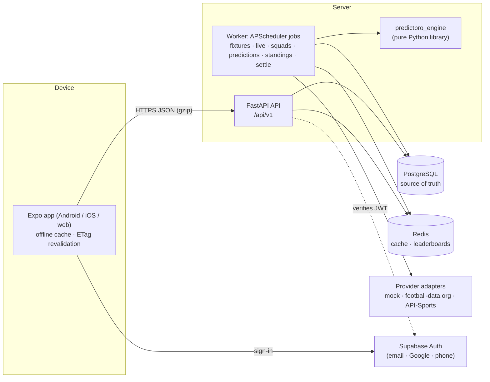

# Architecture

MK Sports runs in two modes:

* **Device mode (default, the APK):** the phone fetches public data itself and runs the models, the multi-source blend and the pick game locally. No server or account.
* **Server mode (`EXPO_PUBLIC_API_URL` set):** the app talks to the FastAPI backend below, which adds accounts, global/private leaderboards and server-side provider keys.

## Device mode

```
screens ──useApi(path)──▶ api/client ──(no server URL)──▶ data/localApi   (same paths and shapes as the server API)
                                                          ├─ data/espn       ESPN feed: scoreboards (month/year/current), summary, standings, teams, crests
                                                          ├─ data/centre     match centre: line-ups in formation, team stats + xG, shots, timeline; player pages
                                                          ├─ data/more       player leaders, news, tennis, Formula 1, cricket, squads
                                                          ├─ data/history    12 months of results per competition, stored compactly, updated incrementally
                                                          ├─ data/predict    rating books + model + sources → accuracy-weighted blend; pre-kick-off snapshots
                                                          ├─ data/game       picks, locking, settlement, streaks, badges (on the phone)
                                                          └─ engine/         TypeScript port of the Python engine (parity-tested) + ensemble
```

* ESPN's scoreboard accepts a day, a month (`YYYYMM`) or a year (`YYYY`), but not day ranges. History uses whole years for football and months for the NBA; live views merge the "current" scoreboard (refreshed every 20–30 s) over the cached month.
* NBA preseason games are excluded from ratings.
* Head-to-head team sports (football, basketball, NFL, NHL, MLB) go through history, ratings, predictions and the pick game. Tennis, F1 and cricket are shown from their own scoreboards, standings and rankings, with no predictions.
* Downloads follow what the user follows: the home feed fetches only the favourite (or featured) competitions, and a sport's history is downloaded only when its predictions are first needed.
* Themes: `LeagueTheme` re-colours everything inside it from the competition's palette in `data/leagues.ts`. Screens wrap themselves in the competition they show.
* Screens re-render when new results arrive or a background backtest finishes (`onLocalDataChange` → cache invalidation).
* Everything the user creates (picks, points, badges, saved forecasts) stays in AsyncStorage on the phone. "Delete my data" in Settings removes it.

## Server mode




## Why this stack

* **FastAPI + Python for the API**, so the prediction engine is imported in-process. There's one language for the server and the data science, and no RPC hop. The engine is still a separate package (`engine/`) with no dependencies on the API or the database, so it can move into its own service when Phase 3 ML needs different hardware.
* **SQLAlchemy 2 + Alembic**: the same models run on PostgreSQL in production and SQLite for a zero-setup demo and tests. Datetimes are always timezone-aware UTC (`UTCDateTime`).
* **Redis** serves caching and leaderboards (sorted sets). Both have fallbacks (in-process TTL cache, SQL `RANK()`), so Redis is an optimisation, not a dependency.
* **Expo (SDK 58) + expo-router**: one codebase for Android, iOS and web, with file-based routes in `mobile/src/app`.

## Data model

24 tables; see `backend/app/models.py` or [db/schema.sql](../db/schema.sql).

| Group | Tables |
|---|---|
| Catalog (config-driven) | `sports`, `leagues`, `seasons`, `teams`, `players`, `external_refs` (provider id ↔ our id) |
| Matches | `matches`, `match_events`, `standings`, `team_ratings` |
| Predictions | `predictions`: every version, with `trigger`, `input_hash`, `created_at`, and post-match `outcome_correct` / `brier` / `log_loss` |
| Game | `users`, `user_favourites`, `user_picks`, `leaderboard_entries`, `badges`, `user_badges`, `private_leagues`, `private_league_members`, `friendships` |
| Messaging | `notifications`, `device_tokens` |
| Ops | `app_state`, `job_runs` |

Sports and leagues are rows, loaded from `backend/app/data/catalog.json` or the admin API. They carry their own scoring rules, model parameters and provider ids, so new competitions need no code.

## Provider adapter layer

`backend/app/providers/base.py` defines `SportsDataProvider` (`fetch_fixtures`, `fetch_live`, `fetch_squads`, `fetch_standings`) and neutral dataclasses. Sync code (`services/sync.py`) only sees those dataclasses. The provider is chosen per sport (`PROVIDER_FOOTBALL`, `PROVIDER_BASKETBALL`, default `DATA_PROVIDER`), and each league maps its provider id in `provider_refs`. Team and player ids go through `external_refs`, so switching provider doesn't duplicate teams.

`providers/http.py` gives every real provider a token-bucket rate limiter, Redis-backed response caching with per-call TTLs, and retry/backoff that honours `Retry-After`.

**Mock provider** (`providers/mock.py`): round-robin schedules anchored to a fixed date stored in `app_state`. Results come from hidden team strengths via a per-match seeded RNG, so they are deterministic. Matches progress in real time when polled (minute, events, quarters). Availability changes weekly. Cycles roll into new seasons, so the demo never runs out of fixtures.

## Jobs

| Job | Interval | Notes |
|---|---|---|
| `live` | 30 s | Exits without any provider call unless a match is `live` or kicks off within 2 min. Bulk "live" endpoints are used where available (one request for all leagues). |
| `fixtures` | 30 min | Window −2 to +14 days: new fixtures, kick-off changes, late results |
| `squads` | 30 min | Injuries/suspensions; changed teams trigger re-prediction (`trigger=team_news`) |
| `predictions` | 15 min | Rebuild ratings from results, predict matches in the next 10 days, store a new version only on meaningful change |
| `standings` | 1 h | Also refreshed immediately when a match in that league ends |
| `settle` | 5 min | Safety net; settlement normally happens on the final whistle |

In development the scheduler runs inside the API (`RUN_SCHEDULER=true`). In production, run **one** `python -m app.cli worker` and set `RUN_SCHEDULER=false` on API replicas, as docker-compose does. Every run (except the high-frequency `live`) is recorded in `job_runs`.

## The pick game

* `PUT /picks/{match}` validates against sport rules (no draws in basketball, the score must agree with the outcome) and rejects with `409 locked` from the scheduled kick-off.
* Settlement (`services/settlement.py`) is **idempotent**: points are recomputed from scratch, and leaderboard totals are rewritten as absolute values (not increments). A corrected score or a re-run never double-counts.
* Streaks follow the order results came in, then kick-off, so a result that is still in progress can never inflate a streak or award a badge early.
* Leaderboards: `leaderboard_entries` is the durable store (global × week/season/all). Redis sorted sets mirror each board and rebuild lazily from SQL if a key is missing. Ranking is competition-style (1, 2, 2, 4).

## Caching & data usage

* Server: shared response caches are keyed by query + a **data version** that jobs bump when match data changes. The viewer's own picks are attached after the cache.
* HTTP: gzip on every response; weak ETags on GET JSON → `304` when unchanged. Responses carry no volatile timestamps, so unchanged data really is byte-identical.
* App (`mobile/src/api/cache.ts`): stale-while-revalidate with AsyncStorage persistence (pruned to 80 entries), per-account cache separation, and polling only on focused screens in the foreground.

## Security & privacy

* Provider keys and the Supabase service-role key exist only in server env vars.
* Dev auth: scrypt (N=2^14) password hashes, HS256 JWTs. Supabase mode: tokens are verified with the project's secret or JWKS; nothing is stored but a user row.
* Tokens are kept in the OS keychain/keystore (`expo-secure-store`); web uses localStorage.
* Consent timestamps are stored. `GET /me/export` returns the user's data; `DELETE /me` deletes everything and the Supabase identity.
* Admin endpoints require `X-Admin-Token`.

## Scaling notes

* Rating books replay a sport's full history every prediction run, which takes milliseconds at this size. Past roughly 100k matches per sport, persist rating state and update it incrementally (the engine's `RatingBook.update` is already incremental).
* The API is stateless and can scale horizontally. Keep one worker, or add leader election (e.g. a Redis lock) before running several.
* Push notifications (Phase 2) attach to the same hooks: settlement emits results, and the fixtures job can schedule reminders and pick-lock warnings into `notifications`. A sender drains that table to FCM.
